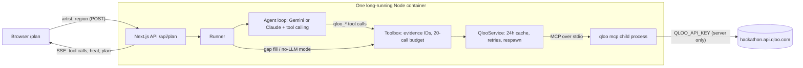

# Opener

**Tour where your fans actually are.**

Opener is an AI tour-routing agent for independent musicians and their managers. Type an artist; Opener uses Qloo's taste graph to find the cities where that artist's audience affinity is strongest, turns them into a routed shortlist of stops, suggests openers whose fans overlap, and reads what else the crowd likes. Every claim links to the Qloo call behind it.

[](LICENSE)


- **Live demo:** `https://<your-render-service>.onrender.com` _(add the URL after deploying)_
- **Screenshot / GIF:** `docs/screenshots/plan.png` _(add after the first live run)_

---

## 1. The problem

Routing a small tour is mostly guesswork. Teams repeat last year's cities, lean on whoever an agent knows, or read a streaming dashboard that says where people listen but not where an audience clusters relative to everyone else. Openers are booked on availability rather than measured fan overlap, and merch or promo choices are made without knowing what the crowd already likes. A plain chatbot doesn't fix this: it can only guess at taste and geography.

## 2. What it does

1. **Map demand.** Pulls Qloo heatmaps for the artist inside the chosen region and turns the hottest cells into ranked cities.
2. **Rank a route.** Picks 5–8 stops, orders them, and gives each a one-line reason tied to a specific Qloo result.
3. **Find openers.** For each city, suggests artists that Qloo recommends for the headliner's audience, scoped with a city location signal for the top markets, and compares the two audiences for the lead pick.
4. **Read the crowd.** Shows relative age and gender affinity, audience tags, and the brands, TV, film, podcasts and local places the audience over-indexes on, plus merch and promo ideas clearly labelled as agent suggestions.
5. **Check momentum.** Reads Qloo's weekly popularity percentile over the past year and calls it rising, steady or cooling.

Every card has a **Qloo evidence** toggle showing the tool, the redacted request input, the status and the key result fields. An evidence drawer lists every call in the run.

## 3. Why it only works with Qloo

| Question                | An LLM alone                                   | Opener with Qloo                                                                                                                |
| ----------------------- | ---------------------------------------------- | ------------------------------------------------------------------------------------------------------------------------------- |
| Where should we play?   | Names big-market cities from general knowledge | Ranks cities from `qloo_where_popular` heat cells for this artist, with the affinity score shown                                |
| Who should open?        | Suggests artists that sound similar            | Uses artists `qloo_recommend` returns for this audience, scoped by city, and checks the lead pick with `qloo_compare_audiences` |
| Who are the fans?       | Repeats genre stereotypes                      | Shows `qloo_audience_demographics` relative affinities, labelled as relative                                                    |
| Is the artist growing?  | Can't tell                                     | Reads `qloo_trends` weekly percentile for the past year                                                                         |
| Can I check the answer? | No sources                                     | Every card links to the Qloo call and its redacted input                                                                        |

The model in Opener plans and explains, but the server only keeps what Qloo backs up: stops must match heatmap-derived cities, and openers must appear in a recommend or rank result. Anything else is dropped and the drop is reported in the plan's limitations.

## 4. How it works



### The agent loop

1. **Resolve.** The server calls `qloo_describe` (type `artist`). If Qloo returns `needs_input`, the run stops and the UI shows the candidates. Opener never auto-picks an ambiguous name. Other plausible matches the harness noted appear as "Not the right artist?" links.
2. **Plan.** The LLM (Gemini `gemini-3.6-flash` by default, falling back to `gemini-3.8-flash` and `gemini-3.5-flash-lite` when a model is busy; or Claude `claude-sonnet-5-5`) gets the real tool schemas from `listTools()` and calls Qloo tools itself: heatmaps for each area, opener recommendations (broad and city-scoped), crossover categories, demographics, tags, trends and an audience comparison. Each call is cached, gets an evidence ID (`ev3`) and streams to the UI. The run is capped at 20 Qloo calls and about 60 seconds.
3. **Draft.** The model returns one JSON draft (summary, stops, openers, spotlight, merch ideas) where every reason cites evidence IDs. The server validates it with Zod and runs one repair pass if needed.
4. **Ground.** The server builds the final `TourPlan` from evidence: cities must match heatmap-derived cities, openers must exist in recommend/rank results, and evidence IDs must exist. Numbers (affinity, demographics, momentum) are always computed from Qloo results, never taken from the model.
5. **Fill gaps.** Any section the agent skipped is filled by a fixed tool chain. With no LLM key, that chain builds the whole plan (labelled "deterministic planner").

### Tool chain

| Feature                          | Qloo tool                    | Arguments Opener sends                                                                           |
| -------------------------------- | ---------------------------- | ------------------------------------------------------------------------------------------------ |
| Resolve the artist               | `qloo_describe`              | `entity`, `type: "artist"`                                                                       |
| Demand map and city ranking      | `qloo_where_popular`         | `entity` (Qloo ID), `entity_type: "artist"`, `within` (country), `limit: 20`                     |
| Openers                          | `qloo_recommend`             | `target_type: "artist"`, `signals: [artist ID]`, optional `signal_location: "City, Country"`     |
| Opener shortlist ranking (agent) | `qloo_rank`                  | `options`, `option_type: "artist"`, `signals`, `signal_location`                                 |
| Why this opener                  | `qloo_compare_audiences`     | `group_a: [headliner]`, `group_b: [opener]`                                                      |
| Crossover tastes                 | `qloo_recommend`             | `target_type`: `brand`, `tv_show`, `movie`, `podcast`; `place` with `filter_location` = top city |
| Who over-indexes                 | `qloo_audience_demographics` | `entity`, `entity_type: "artist"`                                                                |
| Audience tags                    | `qloo_entity_tags`           | `entities: [artist ID]`                                                                          |
| Momentum                         | `qloo_trends`                | `entities`, `entity_type: "artist"`, last 365 days, `limit: 20`                                  |
| Readiness                        | `qloo_capabilities`          | none (makes no Qloo request)                                                                     |

The exact input schemas captured from harness 0.1.26 are in [`docs/qloo-tool-schemas.json`](docs/qloo-tool-schemas.json) (`npm run inspect-tools` regenerates them).

## 5. Request-to-result walkthrough

This walks one request through the system. The **requests** below are exactly what Opener sends. The **response shape** comes from Qloo's public heatmap documentation. Replace the placeholder values with a real trace from `npm run plan -- "<artist>" north-america` (the CLI prints every call with its evidence ID) before submitting.

**1. Input.** `POST /api/plan {"artist": "<artist name>", "region": "north-america"}`. The region preset expands to `within: ["United States", "Canada"]`, because Qloo resolves `within` to a locality and country names resolve reliably.

**2. Resolve (`ev1`).**

```json
{ "tool": "qloo_describe", "input": { "entity": "<artist name>", "type": "artist" } }
```

Result: `status: "ok"` with one entity `{ "entity_id": "<uuid>", "name": "<artist name>" }`. Had the name been ambiguous, the result would be `needs_input` with `resolution.issues[0].candidates`, and the UI would ask.

**3. Demand (`ev2`).** Opener passes the Qloo ID, not the name, so the call cannot drift to a different artist:

```json
{
  "tool": "qloo_where_popular",
  "input": { "entity": "<uuid>", "entity_type": "artist", "within": "United States", "limit": 20 }
}
```

The harness turns this into a `/v2/insights` request with `filter.type=urn:heatmap`. Results are grid cells, trimmed:

```json
{
  "status": "ok",
  "results": [
    {
      "location": { "latitude": 0.0, "longitude": 0.0, "geohash": "…" },
      "query": { "affinity": 0.0, "affinity_rank": 0.0, "popularity": 0.0 }
    }
  ]
}
```

**4. Cell → stop #1.** Opener maps each cell to the nearest city in its bundled GeoNames table (within 90 km, preferring larger cities when two are close), keeps each city's strongest cell, and ranks cities by that affinity. The top city becomes stop #1 with the reason _"Strong audience affinity for &lt;artist&gt;: Qloo's heatmap scored 0.xx at the top cell near &lt;city&gt; across n nearby heat cells"_, citing `ev2`.

**5. Openers (`ev4`–`ev7`).** `qloo_recommend` with `target_type: "artist"`, `signals: ["<uuid>"]`, and for the top three cities `signal_location: "<City>, <Country>"`. Each opener on a stop cites the calls that returned it.

**6. Why this opener (`ev16`).**

```json
{
  "tool": "qloo_compare_audiences",
  "input": { "group_a": ["<headliner uuid>"], "group_b": ["<opener uuid>"], "limit": 10 }
}
```

The comparison's named items appear in the "Why &lt;opener&gt; opens" panel, with the agent's one-line note clearly marked as interpretation.

## 6. Tech stack

- **Next.js 15** (App Router, TypeScript strict) served with `next start` in one Docker container
- **@qloo/qloo-harness** `qloo mcp` over stdio via **@modelcontextprotocol/sdk**
- **@google/genai** (Gemini 3.8 Flash, free tier) or **@anthropic-ai/sdk** (Claude Sonnet 5.5) tool-calling loop behind a small provider interface
- **Zod** for request, agent draft and plan validation
- **MapLibre GL** with free Carto dark tiles (OpenStreetMap data), no map token
- **Tailwind CSS v4**, Inter (self-hosted via Fontsource)
- **Vitest** and **Playwright**
- **GeoNames** cities15000 subset (CC BY 4.0) for cell-to-city mapping, bundled as JSON

## 7. Run locally

You need a Qloo hackathon key. An LLM key is optional but recommended: a free Gemini key from [Google AI Studio](https://aistudio.google.com) (or an Anthropic key) turns on the agent. Without one, Opener uses its deterministic planner.

### macOS / Linux

```sh
# 1. Node.js 22.19 or newer (nvm shown; any installer works)
nvm install 22 && node --version

# 2. Qloo harness 0.1.26+
npm install --global @qloo/qloo-harness
qloo --version

# 3. Environment (hackathon keys only work against the hackathon API)
export QLOO_BASE_URL="https://hackathon.api.qloo.com"
export QLOO_TRUSTED_BASE_URL="https://hackathon.api.qloo.com"
qloo setup --qloo            # paste the key when prompted (stored in the harness config)
qloo setup --status          # look for "Qloo data: ready"
export GEMINI_API_KEY="…"    # optional: free key from Google AI Studio (or ANTHROPIC_API_KEY)

# 4. App
git clone https://github.com/softalpha0/opener.git && cd opener
npm install
npm run inspect-tools        # saves docs/qloo-tool-schemas.json and prints each tool's inputs
npm run dev                  # http://localhost:3000
```

### Windows (PowerShell)

```powershell
# 1. Node.js 22.19 or newer
winget install OpenJS.NodeJS.LTS
node --version

# 2. Qloo harness 0.1.26+
npm install --global @qloo/qloo-harness
qloo --version

# 3. Environment
$env:QLOO_BASE_URL="https://hackathon.api.qloo.com"
$env:QLOO_TRUSTED_BASE_URL="https://hackathon.api.qloo.com"
qloo setup --qloo
qloo setup --status
$env:GEMINI_API_KEY="…"      # optional: free key from Google AI Studio (or ANTHROPIC_API_KEY)

# 4. App
git clone https://github.com/softalpha0/opener.git; cd opener
npm install
npm run inspect-tools
npm run dev
```

Instead of `qloo setup --qloo`, you can set `QLOO_API_KEY` in your shell or in `.env.local` (copy `.env.example`). Never commit it.

### Useful scripts

| Script                              | What it does                                                                                     |
| ----------------------------------- | ------------------------------------------------------------------------------------------------ |
| `npm run plan -- "Artist" [region]` | One plan from the CLI against live Qloo; prints each tool call                                   |
| `npm run warm-cache`                | Runs the three sample artists, warms the cache, writes `data/samples/*.json`                     |
| `npm run inspect-tools`             | Dumps the live `qloo mcp` tool schemas                                                           |
| `npm run check-llm`                 | Sends one tiny request to the configured LLM (Gemini or Claude) and reports latency or the error |
| `npm test` / `npm run test:e2e`     | Vitest unit + integration tests / Playwright smoke tests                                         |
| `npm run test:all`                  | Lint, typecheck, unit and E2E tests                                                              |

## 8. Deploy to production

`qloo mcp` is a local stdio process that Opener keeps running for the life of the server. **Serverless platforms (Vercel functions, Netlify functions, Lambda) are not supported**: they can't keep a child process alive between requests, and a browser can't start one. Deploy the Docker image as a long-running web service.

### Render (default)

1. Push this repo to GitHub.
2. In Render, **New → Blueprint**, pick the repo. `render.yaml` defines one Docker web service with health check `/api/health`.
3. Set the secrets when prompted: `QLOO_API_KEY` (required) and `GEMINI_API_KEY` or `ANTHROPIC_API_KEY` (optional; leave the other blank). `QLOO_BASE_URL` and `QLOO_TRUSTED_BASE_URL` are set as plain values.
4. Use the **Starter** plan or higher. Free instances sleep, so a judge's first request would wait on a cold start.
5. Deploy, then open `/api/health`. You want `"qloo": "ready"` and a harness version of 0.1.26 or newer.
6. Optional: add a custom domain, and attach a persistent disk at `/app/.cache` (see the commented block in `render.yaml`) so the 24-hour cache survives deploys.

`OPENER_WARM_ON_START=true` (set in `render.yaml`) runs the sample artists once after boot so the landing-page examples load from cache.

### Railway or Fly.io

Both build the `Dockerfile` as is. Set the same environment variables, expose port 3000 (`PORT` is honoured), point the health check at `/api/health`, and keep at least one instance always running (Fly: `min_machines_running = 1`, `auto_stop_machines = false`).

### Local Docker

```sh
docker build -t opener .
docker run --rm -p 3000:3000 -e QLOO_API_KEY=… -e GEMINI_API_KEY=… opener
```

## 9. Environment variables

| Name                           | Required | Description                                                       | Example                                  |
| ------------------------------ | -------- | ----------------------------------------------------------------- | ---------------------------------------- |
| `QLOO_API_KEY`                 | Yes      | Qloo hackathon key. Read only by the `qloo mcp` child process.    | `your-qloo-hackathon-key`                |
| `QLOO_BASE_URL`                | Yes      | Hackathon API base URL (defaulted if unset).                      | `https://hackathon.api.qloo.com`         |
| `QLOO_TRUSTED_BASE_URL`        | Yes      | Same URL; the harness only sends the key to trusted hosts.        | `https://hackathon.api.qloo.com`         |
| `GEMINI_API_KEY`               | No       | Enables the agent with Gemini (free tier available).              | `your-gemini-key`                        |
| `ANTHROPIC_API_KEY`            | No       | Enables the agent with Claude instead.                            | `your-anthropic-key`                     |
| `LLM_PROVIDER`                 | No       | `gemini` or `anthropic`; only needed when both keys are set.      | `gemini`                                 |
| `LLM_MODEL`                    | No       | Model override for the chosen provider.                           | `gemini-3.6-flash`                       |
| `OPENER_LLM_FALLBACKS`         | No       | `off` disables server-side refusal fallback.                      | `on`                                     |
| `OPENER_RATE_LIMIT_PER_MINUTE` | No       | Live plans per IP per minute (cached plans don't count).          | `5`                                      |
| `OPENER_CACHE_DIR`             | No       | Where the persistent cache lives.                                 | `/app/.cache`                            |
| `OPENER_CACHE_TTL_HOURS`       | No       | Cache lifetime.                                                   | `24`                                     |
| `OPENER_WARM_ON_START`         | No       | Pre-warm the sample artists after boot.                           | `true`                                   |
| `OPENER_AGENT_TIME_MS`         | No       | Time budget for the agent loop, in ms.                            | `90000`                                  |
| `GEMINI_FALLBACK_MODELS`       | No       | Comma-separated models to try when the main Gemini model is busy. | `gemini-3.8-flash,gemini-3.5-flash-lite` |
| `OPENER_SAMPLES_DIR`           | No       | Override the saved-plan folder (tests use fixtures).              | `data/samples`                           |
| `PORT`                         | No       | HTTP port.                                                        | `3000`                                   |

## 10. Data handling and responsible use

- **Aggregate affinities only.** Qloo results describe how an audience over- or under-indexes. Opener says "strong audience affinity", never "X% of fans will buy tickets", and never describes individuals.
- **No personal data sent.** Inputs are public artist names and country names. Opener has no accounts and stores no visitor data beyond a per-IP request counter in memory.
- **Key stays on the server.** `QLOO_API_KEY` is passed only to the `qloo mcp` child. It is never in the browser bundle, prompts, logs or evidence (a redaction helper scrubs secret-looking keys and the key value itself).
- **What the LLM sees.** Only public artist names and Qloo's aggregate results. Google's free Gemini tier may use prompts to improve its products; use a paid key or Claude if that matters for your deployment.
- **Provenance shown.** Qloo data carries a gold "Qloo data" badge and an evidence toggle; the agent's words carry a dashed "Agent interpretation" badge.
- **What results do not establish:** ticket demand, venue fit, routing feasibility, or the preferences of any particular person. Demographic values are relative affinities, not shares of fans. Saved plans are always labelled "Saved result from &lt;timestamp&gt;".

## 11. Known limitations

- Coverage varies by region. Presets search a few large countries each (Qloo needs a resolvable locality for `within`), so smaller markets can be missed.
- Heatmap affinity is relative to the query. It shows where the audience over-indexes, not how many tickets would sell.
- Cells more than 90 km from a city in the bundled table are left out, and two nearby cities can merge into the larger one.
- Venue capacity, dates, drive times and holds are not modelled yet.
- `qloo_compare_audiences` returns different shapes by entity type; Opener shows the named items it finds.
- The agent's route order is its own interpretation; the deterministic planner uses a greedy nearest-neighbour order.
- The in-memory rate limiter is per instance. Running several instances needs a shared store.

## 12. Roadmap

- Venue capacity matching per city
- Date and drive-time aware routing (holds, off days, max legs)
- A shareable, read-only plan page for booking agents with comments
- Per-city opener ranking with `qloo_rank` across the full shortlist
- Compare two candidate routes side by side

## 13. Troubleshooting

| Problem                                                               | Fix                                                                                                                                                                                                               |
| --------------------------------------------------------------------- | ----------------------------------------------------------------------------------------------------------------------------------------------------------------------------------------------------------------- |
| `qloo` not found                                                      | Install Node 22.19+, run `npm install --global @qloo/qloo-harness`, open a new terminal, check `qloo --version`.                                                                                                  |
| `/api/health` says `"qloo": "missing"` or plans fail with `QLOO_AUTH` | The server has no usable key. Run `qloo setup --status`, or set `QLOO_API_KEY` in the server environment and restart. If a key is set and it still fails, the key was rejected: ask the organisers for a new one. |
| Windows can't find `qloo` (PATH)                                      | `where.exe qloo` shows the full path. Open a new PowerShell after installing, or add the npm global folder (`npm prefix -g`) to PATH.                                                                             |
| Rate limited                                                          | Opener allows 5 live plans per IP per minute; cached plans don't count. Qloo's own rate limits return a retryable error, which Opener retries twice with backoff, then offers a saved plan.                       |
| Plans are slow                                                        | First runs make up to 20 Qloo calls. Repeat runs come from the 24-hour cache. Set `OPENER_WARM_ON_START=true` to warm the samples after deploy.                                                                   |
| Map is blank                                                          | The Carto basemap couldn't load (network or ad-blocker); Opener falls back to a plain dark canvas, and the route list still works.                                                                                |

## 14. License

[MIT](LICENSE). City data from [GeoNames](https://www.geonames.org/) (CC BY 4.0). Map tiles © [CARTO](https://carto.com/attributions), data © OpenStreetMap contributors. Taste data from [Qloo](https://www.qloo.com/).
