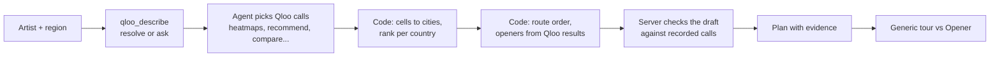
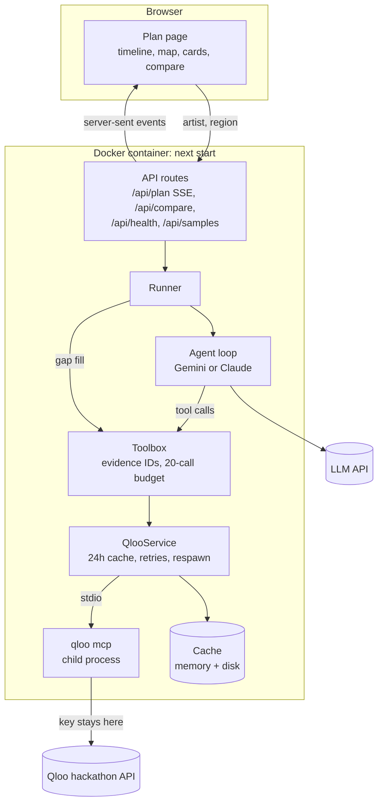

# Opener

[](https://github.com/softalpha0/Opener/actions/workflows/ci.yml)
[](LICENSE)

**An AI tour-routing agent for independent artists: it plans the tour around where Qloo says the fans are, not where the big cities are.**

An indie artist with a few thousand fans in five countries has to pick eight cities. With no data, the list writes itself: the biggest cities, the ones the last band played, the ones a promoter knows. Half of those rooms are full of people who have never heard the artist, the door money doesn't cover the van, and the tour loses money. The fans who would have sold out a smaller room two hours away never hear about the show. Opener replaces the guess with Qloo's taste data: where this artist's audience over-indexes, who else that audience likes, and what the crowd is into.

- **Live app:** `LIVE_URL` _(replace with the Render or Hugging Face link)_
- **One-click sample:** `LIVE_URL/plan?artist=Rema&region=africa`
- **Demo video:** _add the link after recording_
- **Evidence from real runs:** [`evidence/`](evidence/)

## Contents

1. [The problem](#the-problem)
2. [What Opener does](#what-opener-does)
3. [Try it in a minute](#try-it-in-a-minute)
4. [How it works](#how-it-works)
5. [Architecture](#architecture)
6. [Where Qloo fits](#where-qloo-fits)
7. [What the model does, and what it never does](#what-the-model-does-and-what-it-never-does)
8. [Guarantees](#guarantees)
9. [Generic vs Opener](#generic-vs-opener)
10. [Tech stack](#tech-stack)
11. [Running it yourself](#running-it-yourself)
12. [Testing](#testing)
13. [Project layout](#project-layout)
14. [Known limitations](#known-limitations)
15. [Build log](#build-log)
16. [Credits](#credits)

## The problem

Routing a small tour is mostly guesswork. Teams repeat last year's cities, lean on whoever an agent knows, or read a streaming dashboard that says where people listen but not where an audience clusters relative to everyone else. Openers are booked on availability, not measured fan overlap. Merch and promo are chosen without knowing what the crowd already likes.

A chatbot doesn't fix this. Ask a language model where an indie act should play and it lists the largest cities in the country, because that is all it can know without data. Opener shows that answer next to the Qloo-ranked one, on every plan, so you can see the difference.

## What Opener does

Type an artist and pick a region (North America, US, Europe, UK & Ireland, Latin America, Africa, Australia & NZ, or Worldwide). Opener:

1. Resolves the artist in Qloo, and asks you to choose if the name is ambiguous.
2. Pulls a Qloo heatmap for each country in the region and turns the hottest cells into ranked cities.
3. Picks 5–8 stops, routes them country by country, and shows the Qloo signals behind each one.
4. Suggests openers per city from artists Qloo recommends to the same audience, using the city as a location signal.
5. Compares the headliner's and lead opener's audiences, shows who over-indexes by age and gender, and lists the brands, TV, films, podcasts and local places the crowd likes.
6. Puts a generic, no-data tour next to its own, and ranks every generic city against Qloo.

| Outcome                                                   | Where you see it                |
| --------------------------------------------------------- | ------------------------------- |
| A routed shortlist of 5–8 cities with a reason each       | Route list and map              |
| "Why this city" in plain words: rank, affinity, cells     | Every stop card                 |
| Openers with Qloo affinity scores, per city               | Every stop card                 |
| What a plain LLM would have picked, and how Qloo rates it | "Generic tour vs Opener" panel  |
| Every Qloo call, its input, timing and result fields      | "Under the hood" drawer         |
| The crowd: demographics, tags, brands, shows, places      | Audience and taste panels       |
| A shareable link, Markdown copy and JSON download         | Buttons at the top of each plan |

## Try it in a minute

1. Open the live app (`LIVE_URL`). No login.
2. Under **Try an example**, click one of the four sample artists (Phoebe Bridgers, Khruangbin, Rema, Sia). Each runs a live plan, or loads it from the 24-hour cache if it ran recently.
3. Watch the **Agent timeline**: four steps with their durations, and every Qloo call as it happens.
4. When the plan appears, click **Generic vs Opener**. The left column is the tour a model suggests from its own knowledge; the right is Opener's. Each generic city shows where Qloo actually ranks it.
5. Open any stop's **Why this city** box, then **Qloo evidence** on the card for the raw call.
6. Click **Under the hood** to see every Qloo request behind the plan.
7. Try your own artist and region from the form at the top.

If the free server was asleep, the first page load takes about a minute.

## How it works

1. **Understand the artist.** The server calls `qloo_describe`. If Qloo says the name is ambiguous, the run stops and shows the candidates. Every later call uses the resolved Qloo ID, not the name.
2. **Query Qloo.** An LLM agent (Gemini by default, Claude optional) gets the real Qloo tool schemas and decides which calls to make: a heatmap per country, opener recommendations (broad and per city), audience comparison, demographics, tags, trends and crossover tastes. Each call gets an evidence ID like `ev3` and streams to the browser. Without an LLM key, a fixed tool chain makes the same calls.
3. **Rank cities and pick openers.** Code maps each heat cell to the nearest city in a bundled GeoNames table (inside the searched country, within 90 km), merges cities closer than 110 km, and ranks them by affinity within each country. Openers must come from a Qloo recommend or rank result.
4. **Build the route and check the write-up.** Code orders the stops country by country with nearest-neighbour hops. The model's draft is checked against the recorded calls: a stop survives only if its city came from a heatmap, an opener only if Qloo returned it, a citation only if the evidence ID exists.



## Architecture

One Next.js app in one long-running Docker container. The container keeps a single `qloo mcp` process alive and talks to it over stdio. That is why Opener can't run on serverless functions.



## Where Qloo fits

Opener calls Qloo only through the `qloo mcp` tools from `@qloo/qloo-harness`. The "Qloo API" column says what each tool asks Qloo, from the tool's own description.

| What Opener does                              | Qloo tool → Qloo API                                                  | File                                          |
| --------------------------------------------- | --------------------------------------------------------------------- | --------------------------------------------- |
| Resolve the artist, never guess               | `qloo_describe` → entity lookup                                       | `lib/agent/runner.ts`                         |
| Find where the audience over-indexes          | `qloo_where_popular` → Insights heatmap, one per country              | `lib/agent/gather.ts` (`ensureHeat`)          |
| Turn heat cells into ranked cities            | (uses the heatmap result)                                             | `lib/plan/cities.ts`, `lib/agent/gather.ts`   |
| Openers, broad and per city                   | `qloo_recommend` → Insights, `target_type: artist`, `signal_location` | `lib/agent/gather.ts` (`ensureOpeners`)       |
| Rank an opener shortlist (agent)              | `qloo_rank`                                                           | agent tool, `lib/agent/runner.ts`             |
| Why this opener                               | `qloo_compare_audiences` → Insights compare                           | `lib/agent/gather.ts` (`ensureCompare`)       |
| Who over-indexes                              | `qloo_audience_demographics` → Insights `urn:demographics`            | `lib/agent/gather.ts` (`ensureAudience`)      |
| Audience tags                                 | `qloo_entity_tags` → Insights `urn:tag`                               | `lib/agent/gather.ts` (`ensureAudience`)      |
| Momentum over the past year                   | `qloo_trends`                                                         | `lib/agent/gather.ts`, `lib/plan/momentum.ts` |
| Crossover: brands, TV, film, podcasts, places | `qloo_recommend` with other `target_type`s                            | `lib/agent/gather.ts` (`ensureCrossover`)     |
| Rank a generic tour's cities                  | (reuses the plan's heatmaps; no extra calls)                          | `lib/plan/generic.ts`                         |
| Readiness check                               | `qloo_capabilities` (no Qloo request)                                 | `lib/qloo/client.ts`, `app/api/health`        |

Every call goes through `lib/qloo/client.ts`: one connection, a 30-second timeout, a 24-hour cache, and up to two retries when Qloo marks an error as retryable. The exact tool schemas captured from `@qloo/qloo-harness` 0.1.26 are in [`docs/qloo-tool-schemas.json`](docs/qloo-tool-schemas.json).

## What the model does, and what it never does

| The model (Gemini or Claude)                                        | Deterministic code                                                   |
| ------------------------------------------------------------------- | -------------------------------------------------------------------- |
| Chooses which Qloo tools to call and with what arguments            | Resolves the artist first and stops on ambiguous names               |
| Writes the summary, stop reasons, opener notes and merch ideas      | Maps heat cells to cities, merges neighbours, ranks per country      |
| Cites evidence IDs for each claim                                   | Checks every city, opener and evidence ID against the recorded calls |
| Suggests the generic, no-data tour (with no tools and no Qloo data) | Orders the route, computes distances and momentum                    |
|                                                                     | Takes every number (affinity, rank, cells, demographics) from Qloo   |

The model never: sets a number shown on the page, adds a city or opener Qloo didn't return (the server drops it and says so), sees the Qloo key, or sees anything in the generic-tour prompt beyond the artist's name and the countries.

## Guarantees

Only what the code enforces.

| Guarantee                                               | How                                                                                            | Where                                                    |
| ------------------------------------------------------- | ---------------------------------------------------------------------------------------------- | -------------------------------------------------------- |
| The Qloo key never reaches the browser, prompts or logs | Key passed only to the `qloo mcp` child; secret-looking values scrubbed from logs and evidence | `lib/qloo/client.ts`, `lib/qloo/redact.ts`, `lib/log.ts` |
| Ambiguous artists are never auto-picked                 | Run stops on `needs_input` and returns candidates                                              | `lib/agent/runner.ts`                                    |
| Every stop and opener is backed by a Qloo call          | Draft grounding drops anything not in the recorded results                                     | `lib/agent/compose.ts`                                   |
| Every plan matches its schema                           | Zod validation before anything is sent                                                         | `lib/plan/schema.ts`, `lib/agent/runner.ts`              |
| A plan never needs more than 20 Qloo calls              | Toolbox budget                                                                                 | `lib/agent/toolbox.ts`                                   |
| A slow or missing LLM doesn't break the plan            | 90s agent budget, then the fixed planner gets its own 45s                                      | `lib/agent/runner.ts`, `lib/agent/toolbox.ts`            |
| No call hangs forever                                   | 30s per Qloo call, 25s/60s per Gemini turn, 45s client timeout on comparison                   | `lib/qloo/client.ts`, `lib/agent/gemini.ts`              |
| Repeat demos don't spend quota                          | 24h cache for Qloo results, plans and generic tours                                            | `lib/qloo/cache.ts`, `lib/server.ts`                     |
| One visitor can't drain the quota                       | 5 new plans and 5 comparisons per IP per minute                                                | `lib/rate-limit.ts`, `app/api/plan`, `app/api/compare`   |
| Saved plans are never shown as live                     | Labelled "Saved result from <timestamp>"                                                       | `components/PlanResults.tsx`                             |

## Generic vs Opener

Every plan has a **Generic vs Opener** button. The server asks the configured model for a tour using only the artist's name and the countries (`lib/plan/generic.ts`, `genericPrompt`), with no tools and no Qloo data. If no LLM is configured or it fails, the generic tour is the largest cities by population, and the page says which one you're looking at. Each generic city is then looked up in the Qloo heatmaps the plan already fetched.

From [`evidence/sia-worldwide/`](evidence/sia-worldwide/summary.md), a real Qloo run (Sia, five countries) compared offline with the population baseline:

| Generic (population) | What Qloo says                       | Opener picked it? |
| -------------------- | ------------------------------------ | ----------------- |
| New York City        | #2 of 11 cities in the US heatmap    | Yes               |
| London               | #1 of 4 in the UK                    | Yes               |
| Berlin               | #1 of 8 in Germany                   | Yes               |
| Lagos                | #1 of 8 in Nigeria                   | Yes               |
| Sydney               | #1 of 6 in Australia                 | No                |
| Los Angeles          | #1 of 11 in the US                   | Yes               |
| Birmingham           | No match in Qloo's top UK heat cells | No                |
| Hamburg              | #5 of 8 in Germany                   | No                |

For a global pop star the big-city guess and Qloo mostly agree (5 of 8). Where they differ, Qloo moves the tour: Munich (#2 in Germany) and San Francisco (#3 in the US) instead of Hamburg (#5) and Birmingham (no signal). The gap should be larger for niche artists. Run the comparison for the other samples on the live app, or capture them with `npm run evidence -- LIVE_URL`.

## Tech stack

| Layer       | Choice                                                                            |
| ----------- | --------------------------------------------------------------------------------- |
| App         | Next.js 15 (App Router), React 19, TypeScript strict                              |
| Qloo access | `@qloo/qloo-harness` (`qloo mcp`) over stdio with `@modelcontextprotocol/sdk`     |
| Agent       | `@google/genai` (Gemini, free tier) or `@anthropic-ai/sdk` (Claude), tool calling |
| Validation  | Zod                                                                               |
| Map         | MapLibre GL with Carto tiles (OpenStreetMap data), no token                       |
| Styling     | Tailwind CSS v4, Inter (self-hosted)                                              |
| Geography   | GeoNames cities15000 subset, 1,797 cities, bundled as JSON                        |
| Tests       | Vitest, Playwright                                                                |
| CI          | GitHub Actions                                                                    |
| Hosting     | Docker on Render (free plan) or Hugging Face Spaces                               |

## Running it yourself

You need Node 22.19+, a Qloo hackathon key and, optionally, a free Gemini key from [Google AI Studio](https://aistudio.google.com).

```sh
npm install --global @qloo/qloo-harness   # gives the `qloo` command
git clone https://github.com/softalpha0/Opener.git && cd Opener
npm install
cp .env.example .env.local                 # then put your keys in .env.local
npm run dev                                # http://localhost:3000
```

On Windows PowerShell, use `Copy-Item .env.example .env.local` and `notepad .env.local`.

| Variable                                     | Required | What it does                                             |
| -------------------------------------------- | -------- | -------------------------------------------------------- |
| `QLOO_API_KEY`                               | Yes      | Qloo hackathon key, read only by the `qloo mcp` process  |
| `QLOO_BASE_URL`                              | Yes      | `https://hackathon.api.qloo.com`                         |
| `QLOO_TRUSTED_BASE_URL`                      | Yes      | Same URL; `qloo mcp` only sends the key to trusted hosts |
| `GEMINI_API_KEY`                             | No       | Turns on the Gemini agent and the LLM generic tour       |
| `ANTHROPIC_API_KEY`                          | No       | Uses Claude instead (wins if both keys are set)          |
| `LLM_PROVIDER`, `LLM_MODEL`                  | No       | Force a provider or model                                |
| `GEMINI_FALLBACK_MODELS`                     | No       | Models to try when the first is busy or out of quota     |
| `OPENER_RATE_LIMIT_PER_MINUTE`               | No       | New plans per IP per minute (default 5)                  |
| `OPENER_CACHE_DIR`, `OPENER_CACHE_TTL_HOURS` | No       | Cache location and lifetime (default 24h)                |
| `OPENER_AGENT_TIME_MS`                       | No       | Agent time budget (default 90000)                        |
| `OPENER_WARM_ON_START`                       | No       | Load saved sample plans into the cache at boot           |
| `PORT`                                       | No       | HTTP port (default 3000)                                 |

Every variable has a one-line description in [`.env.example`](.env.example).

Useful scripts:

| Command                             | What it does                                                       |
| ----------------------------------- | ------------------------------------------------------------------ |
| `npm run plan -- "Artist" [region]` | One plan from the terminal against live Qloo                       |
| `npm run warm-cache`                | Runs the sample artists and saves their plans to `data/samples`    |
| `npm run evidence -- LIVE_URL`      | Captures plans and comparisons from a running app into `evidence/` |
| `npm run check-llm`                 | One tiny request to the configured LLM                             |
| `npm run inspect-tools`             | Dumps the live `qloo mcp` tool schemas                             |

**Deploying.** Use a host that runs a Docker container continuously; serverless functions can't keep `qloo mcp` alive.

- **Render (free):** New → Web Service → this repo → Language **Docker** → instance **Free**. Add `QLOO_API_KEY`, `GEMINI_API_KEY`, `QLOO_BASE_URL`, `QLOO_TRUSTED_BASE_URL`, `OPENER_WARM_ON_START=true`, and health check path `/api/health`. The free plan sleeps after about 15 idle minutes.
- **Hugging Face Spaces (free):** create a Docker Space and upload the two files in [`deploy/huggingface/`](deploy/huggingface/); add the keys as secrets.

Check `/api/health` after deploying. You want `"configured": {"qloo": true, "llm": true}`.

## Testing

```sh
npm run lint && npm run typecheck && npm test   # unit and integration
npm run test:e2e                                # Playwright, desktop and phone
```

No test calls the live Qloo API. They use a fake `qloo mcp` with Qloo's real result shapes, plus one recorded real run (`tests/fixtures/recorded/sia-worldwide.json`).

| Area                                  | Tests           | Covers                                                                                                                                                                                |
| ------------------------------------- | --------------- | ------------------------------------------------------------------------------------------------------------------------------------------------------------------------------------- |
| Generic vs Opener (`generic.test.ts`) | 13              | Parsing model replies, population baseline, ranking on recorded Qloo data, no Qloo data in the prompt, caching                                                                        |
| Agent runner (`runner.integration`)   | 8               | Full plan on mocked Qloo, ambiguous and unknown artists, grounding drops invented cities, artists and evidence, agent failure fallback, time budget, per-country ranking, agent steps |
| Gemini provider (`gemini.test.ts`)    | 12              | Busy and quota fallbacks, retries, schema cleaning                                                                                                                                    |
| Ranking and helpers (`plan-helpers`)  | 10              | Cell-to-city mapping, route order, momentum, rate limiter, "Why this city"                                                                                                            |
| Cities and scales (`merge`)           | 6               | Neighbour merging, metro over suburb, border fix, 0–1 percentiles, near-tie ranking                                                                                                   |
| Qloo client (`client.integration`)    | 5               | One connection, caching by normalised args, bounded retries, respawn, readiness                                                                                                       |
| Envelope normalisation (`envelope`)   | 9               | Result parsing, missing status, errors and retryability, `series` for trends                                                                                                          |
| Cache (`cache.test.ts`)               | 8               | TTL, LRU, disk layer                                                                                                                                                                  |
| Schema (`schema.test.ts`)             | 7               | Plan and draft validation, every stop must cite a Qloo call                                                                                                                           |
| Redaction (`redact.test.ts`)          | 4               | Secret-looking fields and the Qloo key value scrubbed at any depth                                                                                                                    |
| End to end (`tests/e2e`)              | 5 × 2 viewports | Landing, saved plan, Why this city, Under the hood, Generic vs Opener, health, no horizontal scroll                                                                                   |

82 unit and integration tests and 10 end-to-end runs. CI runs all of them on every push (`.github/workflows/ci.yml`).

## Project layout

| Path                  | What's there                                                         |
| --------------------- | -------------------------------------------------------------------- |
| `app/`                | Pages (`/`, `/plan`, `/how-it-works`) and API routes                 |
| `app/api/plan`        | Streams a plan as server-sent events                                 |
| `app/api/compare`     | Generic tour and its Qloo ranking for a plan                         |
| `app/api/health`      | Readiness: Qloo and LLM configured, cache stats, no secrets          |
| `components/`         | UI: timeline, map, city cards, compare panel, evidence drawer        |
| `lib/qloo/`           | `qloo mcp` client, cache, envelope normalisation, redaction          |
| `lib/agent/`          | Runner, agent loop, Gemini/Claude providers, grounding, generic tour |
| `lib/plan/`           | Schema, regions, city ranking, routing, comparison, formatting       |
| `lib/geo/`            | Bundled GeoNames city table and lookups                              |
| `scripts/`            | CLI planner, cache warmer, evidence capture, tool inspector          |
| `tests/`              | Unit, integration and E2E tests, fixtures                            |
| `evidence/`           | Real outputs: plans, comparisons and summaries                       |
| `data/samples/`       | Saved sample plans (written by `npm run warm-cache`)                 |
| `docs/`               | Devpost write-up, architecture notes, Qloo tool schemas              |
| `deploy/huggingface/` | Files for a Hugging Face Space                                       |

## Known limitations

- **Heatmap scores are relative within each country.** Multi-country plans rank cities inside each country, not across countries.
- **Coverage depends on the presets.** Each region searches 1–5 large countries, because Qloo's `within` needs a resolvable place. Smaller markets can be missed.
- **Cities come from a bundled table.** Cells more than 90 km from one of the 1,797 cities are dropped, and cities closer than 110 km merge. A generic city missing from the table (Cologne, for example) shows as "no match" even if Qloo has heat nearby.
- **Affinity is not ticket demand.** It shows where the audience over-indexes, not how many tickets would sell.
- **No venues, dates or drive times yet.** Stop reasons cite Qloo signals; there are no venue-level pitches. Route order is nearest-neighbour by straight-line distance.
- **Free LLM tier.** Gemini's free tier can be busy or out of daily quota. The plan then comes from the fixed planner and the generic tour from the population baseline, and the page says so.
- **Small evidence set.** One real run is recorded in this repo so far (Sia, worldwide, captured with the October 23 build, before the per-country ranking and border fixes). Re-capture from the live app with `npm run evidence`.
- **Rate limits and cache are per instance.** Several instances would need a shared store.
- **The free Render plan sleeps** after about 15 idle minutes; the next visit takes about a minute.

## Build log

- **2026-10-22:** Next.js scaffold, `qloo mcp` client with cache and retries, typed Qloo tools, agent runner, plan schema, CLI. SSE plan API, plan page with live timeline, map, city cards and evidence. Landing and how-it-works pages. Dockerfile and Render blueprint. Unit, integration and E2E tests. First README and Devpost draft.
- **2026-10-23:** First live runs on the hackathon API (Phoebe Bridgers, Rema, Sia). Switched the agent to Gemini's free tier with model fallbacks. Fixed cross-country ranking (scores are relative per country), the Buffalo → Toronto border bug, trend percentiles (0–1, not 0–100) and agent time budgets. Added the Africa region preset and Hugging Face deployment files.
- **2026-10-24:** Generic vs Opener comparison, "Why this city" panel, "Under the hood" drawer with timings, live agent steps with durations, fourth sample artist, health check reports configured keys, recorded-data tests, GitHub Actions CI, `evidence/` and capture script, complete `.env.example`, this README and the Devpost write-up.

## Credits

- Taste data from [Qloo](https://www.qloo.com/), through `@qloo/qloo-harness`.
- City data from [GeoNames](https://www.geonames.org/) (CC BY 4.0).
- Map tiles © [CARTO](https://carto.com/attributions), map data © OpenStreetMap contributors, rendered with [MapLibre](https://maplibre.org/).
- Inter typeface by Rasmus Andersson, self-hosted via Fontsource.
- README structure modelled on [Enoch208/cadence](https://github.com/Enoch208/cadence).
- Licensed under [MIT](LICENSE).
